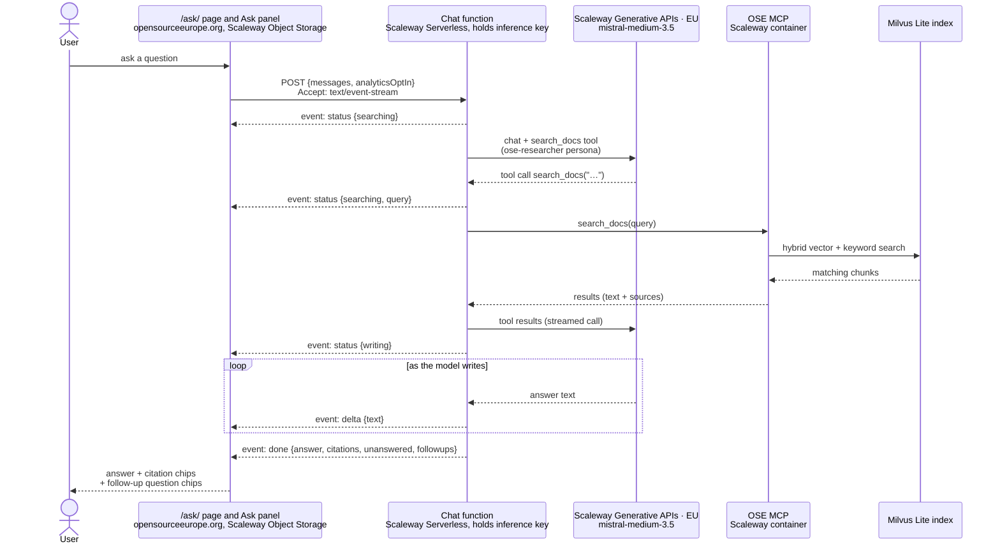
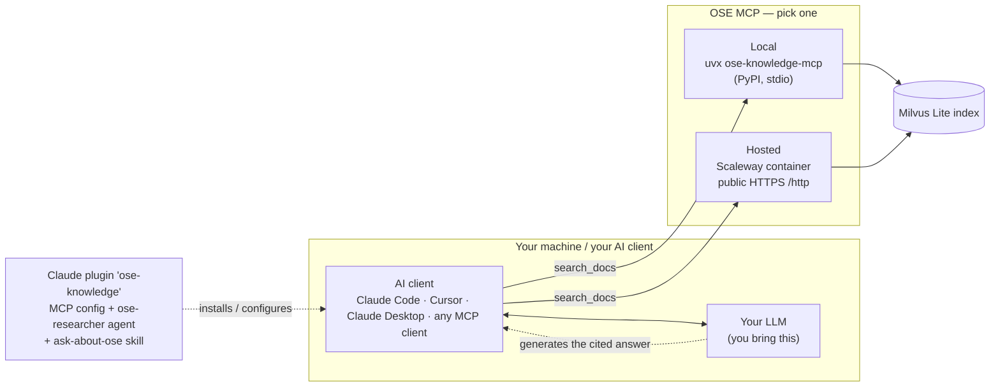

# Architecture

The core product is the documentation MCP server. An optional public chat is layered on top of it.
The RAG (retrieval) is entirely in the MCP server. The answer is generated by whatever LLM the
consumer brings. The chat on opensourceeurope.org is one such consumer, and we host it.

## Components

| Component | Path | Role |
|---|---|---|
| OpenCrane MCP server | `.opencrane/` | The RAG. Indexes the OSE docs into Milvus Lite and exposes the `search_docs` tool over MCP. Shipped two ways: a public Scaleway container and the `ose-knowledge-mcp` PyPI package (runs locally via `uvx`). |
| Claude plugin | `plugins/ose-knowledge/` | Registers the MCP server and an `ose-researcher` agent for Claude Code. |
| Chat *(optional)* | `/ask/` and the Ask panel on the site (`src/pages/`, `src/components/chat/`, `src/scripts/chat/`) + `functions/chat/` | The `/ask/` page and the slide-out panel are part of the static site (Scaleway Object Storage). They call a stateless function (Scaleway Serverless Container) that runs the agent loop with EU-hosted inference (Mistral Medium on Scaleway Generative APIs). It is the only part that calls an LLM or holds a key. |

There are two ways to use the knowledge base, described below.

## Flow 1 — Public chat on the site

We provide the model (Mistral Medium on Scaleway, EU) and the orchestration, so a visitor needs no setup.
Everything in the request path is EU-hosted (sovereign).

The loop (tool call → MCP → results → continue) can repeat up to `MAX_TOOL_ROUNDS`. The browser
asks for Server-Sent Events. The status line in the chat follows the `status` events. The answer
text appears as plain text while it streams, and then `done` replaces it with the cleaned, rendered
answer and its citations. A request without `Accept: text/event-stream` gets one JSON response
with the same object as `done`, and the browser reads that too (see
[`functions/chat/README.md`](../../functions/chat/README.md), "Streaming"). The function
holds the inference key, enforces the origin allowlist, and builds each citation from the
`search_docs` result. A citation links to the exact section (`source_url#section_anchor`) when
OpenCrane supplies one, and to the page otherwise.
Nothing is persisted. The chat logs to Scaleway Cockpit only when the visitor accepted analytics in the site's consent banner. It then logs the answer details. When the visitor closes the panel or leaves the page, it also logs a summary of what was asked and answered without personal data.

## Flow 2 — Your own agent (local or any MCP client)

You bring your own model and client, and you use only the `search_docs` retrieval tool.
No hosted model, chat function or website is involved.

The Claude plugin is a shortcut. It sets up the MCP connection for you and ships the
`ose-researcher` persona. Any MCP client that you point at `uvx ose-knowledge-mcp` (local) or at
the hosted endpoint works the same way.

## Why it's split this way

- Retrieval and generation are separate. The MCP server only *retrieves* (`search_docs` over Milvus).
  Generating a cited answer needs an LLM and a tool-calling loop. That loop runs in the consumer
  (the chat function, or your own agent), never in the MCP server.
- The chat function is thin and optional. It exists only because a *public, static* website
  cannot hold an API key or run the agent loop itself. Without `functions/chat/` and the chat UI, the product
  is still complete: the MCP server, the plugin and the PyPI package.
- One release run ships everything. Merging the release PR runs `release.yml`. In the same run,
  it publishes the `ose-knowledge-mcp` PyPI package, deploys the hosted MCP container, and
  deploys the chat function, the contact function and the site. Each is a downstream job gated on
  release-please's `releases_created` output. The site deploy waits for the PyPI publish, so `/ask/`
  never shows a package version that PyPI lacks. `deploy-chat-function.yml`, `deploy-function.yml`
  and `deploy-site.yml` are reusable workflows that can also be run on their own with
  `workflow_dispatch`.
