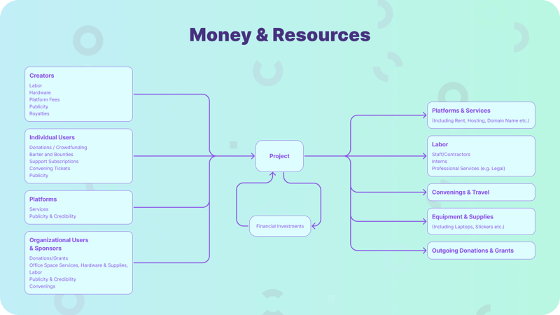

How to use funds for your initiative on OSE

This guide is based on an Open Source Collective workshop led by Sumana Harihareswara of Changeset Consulting in January 2022. It helped open source software projects hosted on Open Collective decide how to use the money they had already raised. We adapted it to the cases we see on OSE, and all examples are in EUR.

## Why You Should (or Shouldn't) Spend Your Money

### Reasons to Spend

* Advance your project. Pay for tasks, chores and infrastructure improvements that are hard to do with volunteer labour alone.
* Attract more donors. When you spend money, donors see that you use their contributions well.
* Experiment and learn. Spending money on pilot projects or services can help you try new approaches and gives you more flexibility.
* Boost morale. Small purchases of merchandise (stickers, awards, t-shirts) can help contributors stay and can improve team morale.

Agree together on rules for spending decisions that suit your Collective's budget. Make clear who can approve expenses and which decisions need a wider discussion. These internal rules do not replace OSE's expense checks or the conditions attached to your funding.

### **Reasons to Save:**

* Specific activities. Save up for large expenses, such as hiring contractors.
* Self-insurance. Keep funds to cover possible risks, such as unexpected hosting costs or legal expenses.
* Budgeting. Make a budget that sets funds aside for self-insurance and for future activities. Then you know clearly how much you can spend.

## Driver and Supporter/Protector Activities

**Drivers:** Activities that directly advance your mission (e.g., software development).

**Supporters:** Infrastructure activities and purchases that support drivers (e.g., organising conferences, buying laptops).

**Protectors:** Activities or expenses that reduce risks (e.g., legal fees, code of conduct workshops).

For instance, in this diagram...

*Money and Resources, shown by those that go into a project and then what comes out of it*

...labor for software development is a driver, because writing the software directly advances the mission of making and improving the open source project. An example of a supporter activity: organizing a conference where the contributors can meet to improve and speed up their work. An example of a supporter purchase: buying a new laptop for a contributor to use.

## Advancing Your Goals and Roadmap

Consider what's on your roadmap and how you can spend to support it.

If your project has no clear goals or written roadmap, you can still spend money on the following:

* Consultants who help you create a roadmap.
* Hardware upgrades for your team's development environment.
* Volunteer contributions. Volunteers can ask for reimbursement of their actual expenses, with the required supporting documents. OSE may consider a separate volunteer allowance arrangement, but it must review and accept the arrangement beforehand. OSE does not accept it automatically.

If you have a roadmap, pay new contractors or services to take repetitive tasks off your existing volunteers.

### Specific Spending Examples

* Independent contractors
* Volunteer reimbursements
* Professional education and tools
* Meet up travel expenses
* Logo design and merchandise
* Co-working space
* Virtual assistant services

### Hiring Contractors

You can hire collaborators for your collective as contractors. You can choose who to hire informally or through a public job posting. See [the invoicing options](/docs/how-it-works/expenses/invoices-or-reimbursements/).

### Using Bounties Cautiously

Patch bounty programs can encourage specific development work. They may also make people compete instead of working together. Use bounties for tasks that volunteers do not want to do or do not have the skills for. OSE treats bounty payments as payments for services: a compliant invoice is required, and the usual payment rules apply.

## Decision-Making and Governance

Open Collective's expense documentation says:

:::note
"The decision is up to you as a project. Some projects are informal, and any Core Contributor can approve any expense. Others have a formal decision-making or budgeting process, or only pay expenses for specific things. We advise you to have a discussion with your collaborators and agree on guidelines for approving expenses."
:::

Also read the documentation on [budget](https://docs.opencollective.com/help/collectives/budget) and [expense policies](https://docs.opencollective.com/help/collectives/collective-settings/expense-policy), and ["ten ways to make decisions about money"](https://blog.opencollective.com/ten-ways-to-make-decisions-about-money/).

* Common concerns:

  * Legal or tax questions: Open Source Europe cannot advise you on the legal or tax obligations of your members or collaborators. We recommend that you contact a legal or tax specialist in their country of residence. For general guidance, use this documentation or contact us at <home@opensourceeurope.org>.
  * Disagreements: act in good faith and support decisions made by the group. Clear policies and consistent practices help a lot.

  People will have reasonable concerns about what you spent, and why and how you spent it. If you are not sure how to prevent or answer those concerns, you have two main options:

  * *Intense up-front transparency*: publish the details of your decisions openly. Tell contributors and observers about possible expenses in advance, make clear who decides, and offer a public comment period before approval. Do this every time, and use Open Collective's tools to keep the records available for later review. This is fairly easy if you manage all expenses through Open Collective invoices.
  * *Post-decision accountability*: do not offer a public comment period before the decision. Instead, run a clear private comment period among the people who decide. Then answer for past expenses: anyone who wants to can ask for details about a specific expense. This lets you make more decisions privately, and you can give some details privately when people ask. Keep in mind that your payees, or the people you answer, may publish details on their own.

## OSE’s role in conflicts

Collectives manage their internal conflicts. OSE intervenes if a situation affects funds or hosting conditions, but does not promise mediation. If you suspect misuse of funds, or have concerns about administrators, contact OSE privately. You do not have to go through those administrators.
