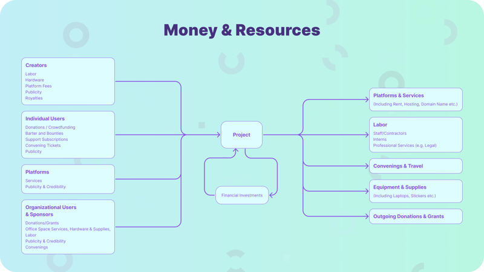

This guide explains how to use funds for your initiative on Open Source Europe (OSE).

This guide is based on an Open Source Collective workshop led by Sumana Harihareswara of Changeset Consulting in January 2022. It helped open source software projects hosted on Open Collective decide how to use the money they had already raised. OSE adapted the workshop content to the cases that OSE sees. All examples are in euros (EUR).

## Why you should (or shouldn't) spend your money

The following sections list reasons to spend and reasons to save.

### Reasons to spend

Spending money can help your project in these ways:

* Advance your project. Pay for tasks, chores, and infrastructure improvements that are hard to do with volunteer labor alone.
* Attract more donors. When you spend money, donors see that you use their contributions well.
* Experiment and learn. Money for pilot projects or services can help you try new approaches and gives you more flexibility.
* Boost morale. Small purchases of merchandise (stickers, awards, and t-shirts) can help contributors stay and can improve team morale.

Agree together on rules for spending decisions that suit your Collective's budget. Make clear who can approve expenses and which decisions need a wider discussion. These internal rules do not replace OSE's expense checks or the conditions attached to your funding.

### Reasons to save

Keep money in reserve for these reasons:

* Specific activities. Save up for large expenses, such as hiring contractors.
* Self-insurance. Keep funds to cover possible risks, such as unexpected hosting costs or legal expenses.
* Budgeting. Make a budget that sets funds aside for self-insurance and for future activities. Then you know clearly how much you can spend.

## Driver and supporter/protector activities

Activities and expenses fall into three groups:

* Drivers are activities that directly advance your mission, for example software development.
* Supporters are infrastructure activities and purchases that support drivers, for example organizing conferences or buying laptops.
* Protectors are activities or expenses that reduce risks, for example legal fees or code of conduct workshops.

The following diagram shows the money and resources that go into a project and come out of it.

*Money and resources that go into a project, and what comes out of it*

In the diagram, labor for software development is a driver, because writing the software directly advances the mission of making and improving the open source project. A conference where the contributors can meet to improve and speed up their work is a supporter activity. A new laptop for a contributor to use is a supporter purchase.

## Advancing your goals and roadmap

Consider what's on your roadmap and how you can spend to support it.

If your project has no clear goals or written roadmap, you can still spend money in the following ways:

* Pay consultants who help you create a roadmap.
* Upgrade the hardware of your team's development environment.
* Reimburse volunteers. Volunteers can ask for reimbursement of their actual expenses, with the required supporting documents. OSE may consider a separate volunteer allowance arrangement, but OSE must review and accept the arrangement beforehand. OSE does not accept such an arrangement automatically.

If you have a roadmap, pay new contractors or services to take repetitive tasks off your existing volunteers.

### Specific spending examples

Collectives spend money on items such as these:

* Independent contractors
* Volunteer reimbursements
* Professional education and tools
* Travel expenses for meetups
* Logo design and merchandise
* Co-working space
* Virtual assistant services

### Hiring contractors

You can hire collaborators for your Collective as contractors. You can choose who to hire informally or through a public job posting. For more information, see [the invoicing options](/docs/how-it-works/expenses/invoices-or-reimbursements/).

### Using bounties cautiously

Patch bounty programs can encourage specific development work. They may also make people compete rather than cooperate. Use bounties for tasks that volunteers do not want to do or do not have the skills for. OSE treats bounty payments as payments for services: each bounty payment needs a compliant invoice, and the usual payment rules apply.

## Decision-making and governance

Open Collective's expense documentation says:

:::note
"The decision is up to you as a project. Some projects are informal, and any Core Contributor can approve any expense. Others have a formal decision-making or budgeting process, or only pay expenses for specific things. We advise you to have a discussion with your collaborators and agree on guidelines for approving expenses."
:::

Also read the Open Collective documentation on [budget](https://docs.opencollective.com/help/collectives/budget) and [expense policies](https://docs.opencollective.com/help/collectives/collective-settings/expense-policy), and the blog post ["Ten ways to make decisions about money"](https://blog.opencollective.com/ten-ways-to-make-decisions-about-money/).

### Common concerns

Two concerns come up often:

* OSE cannot advise you on the legal or tax obligations of your members or collaborators. OSE recommends that you contact a legal or tax specialist in their country of residence. For general guidance, use this documentation or contact OSE at <home@opensourceeurope.org>.
* If people disagree, act in good faith and support decisions made by the group. Clear policies and consistent practices help a lot.

People may have reasonable concerns about what you spent, and why and how you spent it. If you are not sure how to prevent or answer those concerns, you have two main options:

* *Intense up-front transparency*: publish the details of your decisions openly. Tell contributors and observers about possible expenses in advance, make clear who decides, and offer a public comment period before approval. Do this every time, and use Open Collective's tools to keep the records available for later review. This approach is fairly easy if you manage all expenses through Open Collective invoices.
* *Post-decision accountability*: do not offer a public comment period before the decision. Instead, run a clear private comment period among the people who decide. Then answer for past expenses: anyone who wants to can ask for details about a specific expense. This approach lets you make more decisions privately, and you can give some details privately when people ask. Your payees, or the people you answer, may publish details on their own.

## OSE’s role in conflicts

Collectives manage their internal conflicts. OSE intervenes if a situation affects funds or hosting conditions, but does not promise mediation. If you suspect misuse of funds, or have concerns about administrators, contact OSE privately. You do not have to go through those administrators.
