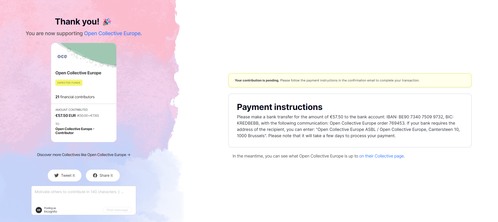
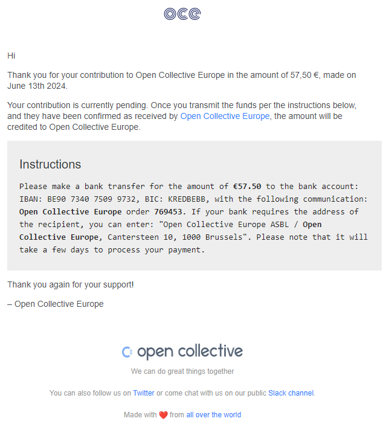

This option is available for all funds.

## Overview

If you prefer to contribute to a Collective by bank transfer, Open Source Europe (OSE) has a simple process for this.

***

## Step-by-Step Guide

1. Start the donation
   * Go to the page of the Collective you want to support.
   * Click the **“Contribute”** button.
   * Select **“Bank Transfer”** as your payment method.
2. Get the transfer instructions
   * After you confirm your contribution, you'll get an email with:
     * OSE's bank account details.
     * A unique **Order Number** for your contribution.
3. Make the bank transfer
   * Start the transfer from your bank, and make sure you:
     * Use exactly the bank details provided.
     * Include the **Order Number** and the **Collective's name** in the payment reference.

:::danger
If you leave out the Order Number or the Collective's name, it may take longer to allocate your funds.
:::

1. Processing time
   * Allow up to seven business days from the date you send the bank transfer for the contribution to appear in the Collective's budget. This is an estimate, not a guarantee. If it has not appeared after this period, contact OSE using the details below.
   * Once the hosting team has confirmed receipt and allocated the transfer to your Collective, the contribution will appear in its budget.

***

## Visual Guide

*Example of the confirmation screen displaying bank transfer details.*

***

## Troubleshooting

* Didn't get the instruction email?
  * Check your spam or junk folder.
  * If it is not there, contact us at <home@opensourceeurope.org>.
* Funds not in the budget seven business days after you sent them?

  * Check that the payment reference included the correct Order Number and Collective's name.
  * Give us:
    * The transaction receipt.
    * The amount sent.
    * The date of transfer.
    * The sender's name.

  Send this information and any supporting documents by email to <home@opensourceeurope.org>, and we will help you. Do not send them through Slack or Discord.

## Hosting fees

See the [current OSE fee reference](/docs/faq/general-faqs/#how-much-does-it-cost).
