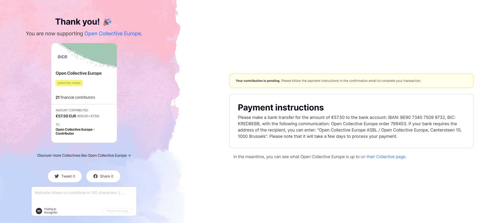
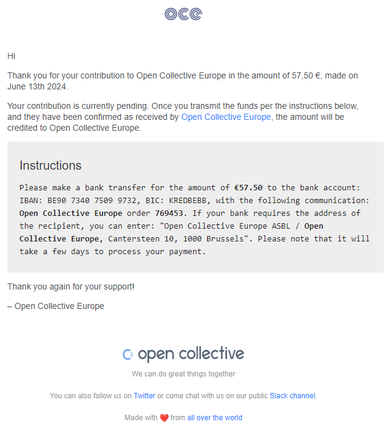

This option is available for all funds.

## Contribute by bank transfer

If you prefer to contribute to a Collective by bank transfer, Open Source Europe (OSE) has a simple process for this payment method.

***

## Step-by-step guide

1. Start the donation
   * Go to the page of the Collective you want to support.
   * Click the **Contribute** button.
   * Select **Bank Transfer** as your payment method.
2. Get the transfer instructions
   * After you confirm your contribution, you'll get an email with:
     * OSE's bank account details
     * A unique **Order Number** for your contribution
3. Make the bank transfer
   * Start the transfer from your bank, and make sure you:
     * Use exactly the bank details provided.
     * Include the **Order Number** and the Collective's name in the payment reference.

:::caution
If you leave out the Order Number or the Collective's name, OSE may need longer to allocate your funds.
:::

4. Wait for the contribution to appear
   * Allow up to seven business days for the contribution to appear in the Collective's budget. Count from the date you send the bank transfer. This time is an estimate, not a guarantee. If the contribution has not appeared after seven business days, contact OSE as described in Troubleshooting.
   * The contribution appears in the Collective's budget once the OSE hosting team confirms receipt and allocates the transfer to the Collective.

***

## Visual guide

*Example of the confirmation screen with the bank transfer details.*

***

## Troubleshooting

Use the following checks when a bank transfer does not go as expected.

### The instruction email did not arrive

Check your spam or junk folder. If the email is not there, contact OSE at <home@opensourceeurope.org>.

### The funds are not in the budget after seven business days

Check that the payment reference included the correct Order Number and the Collective's name. Then give OSE the following details:

* Transaction receipt
* Amount sent
* Date of the transfer
* Sender's name

Send these details and any supporting documents by email to <home@opensourceeurope.org>. OSE then helps you. Do not send them through Slack or Discord.

## Hosting fees

See the [current OSE fee reference](/docs/faq/general-faqs/#how-much-does-it-cost).
