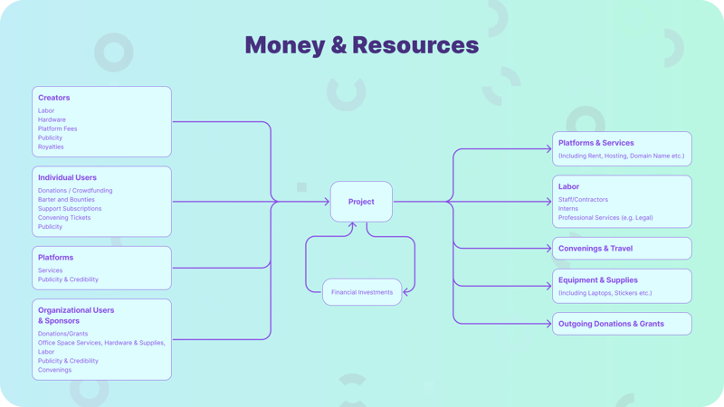

How to use funds for your initiative on OSE

This guide is based on an Open Source Collective workshop led by Sumana Harihareswara of Changeset Consulting in January 2022. It focused on helping Open Collective-hosted open-source software projects decide how to use the money they have already raised. We adapted it for user cases seen on OSE, with all examples in EUR.

## Why You Should (or Shouldn't) Spend Your Money

### Reasons to Spend

* **Advancing your project:** Use funds to complete tasks, chores, and infrastructure improvements that are difficult to achieve with volunteer labour alone.
* **Attracting more donors:** Spending money demonstrates to donors that you use their contributions effectively.
* **Experimenting and learning:** Spending money on pilot projects or services can help you explore new approaches and increase flexibility.
* **Boosting morale:** Small investments in merchandise (stickers, awards, t-shirts) can improve contributor retention and team morale.

Generally, spending less than 10% of your saved funds or making a one-time expenditure of less than 20% of your stable recurring monthly income should be manageable without extensive decision-making.

### **Reasons to Save:**

* **Specific Activities:** Save up for significant expenditures like contractor engagements.
* **Self-Insurance:** Keep funds to cover potential risks, such as unexpected hosting costs or legal expenses.
* **Budgeting:** Develop a budget to delineate funds for self-insurance and future activities, ensuring you have a clear picture of available spending.

## Driver and Supporter/Protector Activities

**Drivers:** Activities that directly advance your mission (e.g., software development).

**Supporters:** Infrastructural activities and purchases that support drivers (e.g., organising conferences, buying laptops).

**Protectors:** Activities or expenses that reduce risks (e.g., legal fees, code of conduct workshops).

For instance, in this diagram...

*Money and Resources, shown by those that go into a project and then what comes out of it*

...labor for software development is a driver, because writing the software directly advances the mission of making and improving the open source project. An example of a supporter activity: organizing a conference where the contributors can meet to improve and speed up their work. An example of a supporter purchase: buying a new laptop for a contributor to use.

## Advancing Your Goals and Roadmap

Consider what's on your roadmap and how you can spend to support it.

If you lack explicit project goals or a written roadmap, you can still invest in the following:

* **Consultants:** Pay for help in creating a roadmap.
* **Hardware Upgrades:** Improve your team's development environment.
* **Mentorship Programs:** Sponsor and mentor interns to build capacity.
* **Volunteer contributions:** Organise volunteers around your activity and reimburse them according to the legislation in their country of residence

If you have a roadmap, pay new contractors or for services to relieve existing volunteers of repetitive tasks.

### Specific Spending Examples

* Independent contractors
* Volunteer reimbursements
* Professional education and tools
* Meet up travel expenses
* Logo design and merchandise
* Co-working space
* Virtual assistant services

### Hiring Contractors

You can hire collaborators for your collective as contractors. You can decide on who you will be hiring informally or through a public job posting process. Please see [here for the possibilities of invoicing](/docs/how-it-works/expenses/invoices-or-reimbursements/).

### Using Bounties Cautiously

Patch bounty programs can incentivise specific development work but may lead to competitive rather than collaborative behaviour. Use bounties for tasks that volunteers are not inclined or skilled to do.

## Decision-Making and Governance

Per Open Collective's expense documentation:

:::note
"The decision is up to you as a project. Some projects are informal, and any Core Contributor can approve any expense. Others have a formal decision-making or budgeting process, or only pay expenses for specific things. We advise you to have a discussion with your collaborators and agree on guidelines for approving expenses."
:::

Please also review the documentation on [budget](https://docs.opencollective.com/help/collectives/budget) and [expense policies](https://docs.opencollective.com/help/collectives/collective-settings/expense-policy) as well as ["ten ways to make decisions about money"](https://blog.opencollective.com/ten-ways-to-make-decisions-about-money/).

* **Common Concerns:**

  * Legal or tax implications: Open Source Europe cannot advise you on your members' or collaborators' legal or fiscal obligations. We recommend contacting a legal or fiscal specialist in their country of residence. For general guidance, please use this documentation or contact us at <oce@opencollective.com>
  * Disagreements: Act in good faith and empower group decisions. Clear policies and consistent practices help a lot in this process.

  People will have reasonable concerns about what you spent, and why and how you spent it, and you're not sure how to preempt or respond to those concerns. You have two major options:

  * *Intense up-front transparency*: invest in publishing details about the decisions transparently. Give contributors and spectators advance notice of possible expenditures, make it clear who has the power to decide, and offer a public comment period before approval. Do this consistently, and use Open Collective's tools to leave the records up for future inspection. This is relatively easy if you are managing all the expenses via Open Collective invoices.
  * *Post-decision accountability*: don't offer a pre-decision public comment period, but run an explicit private comment period among the decision markers, and offer accountability for past expenses such that anyone who wants to can ask for details on particular expenditure choices. This allows you to make more decisions privately, and gives you the option of providing some details privately in response to questions, but keep in mind that your payees or people you answer may publish details on their own.

## OSE’s role in conflicts

Collectives manage their internal conflicts. OSE intervenes if a situation affects funds or hosting conditions, without promising mediation. For suspected misuse of funds or concerns involving administrators, contact OSE privately without having to go through those administrators.
