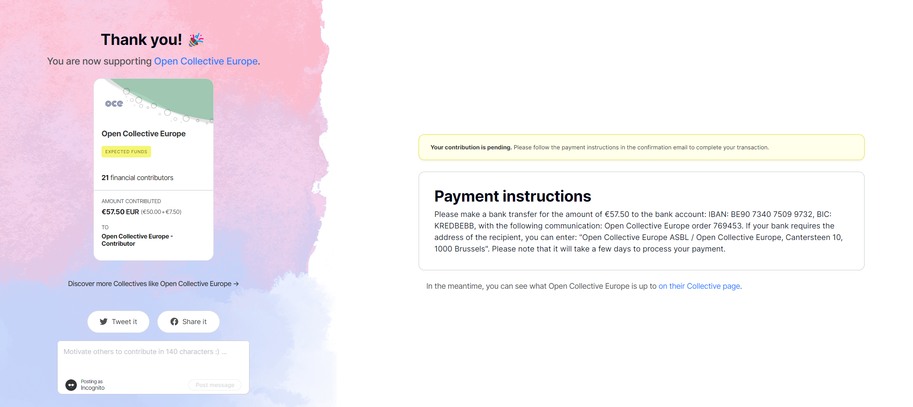
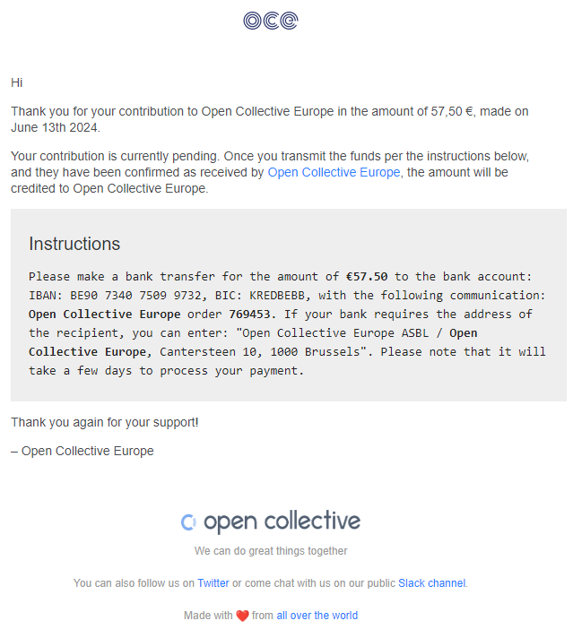

‌

### Overview

If you prefer to contribute to a Collective via bank transfer, Open Source Europe (OSE) provides a straightforward process to facilitate this.

***

### Step-by-Step Guide

1. **Initiate the Donation Process**
   * Navigate to the Collective's page you wish to support.
   * Click on the **“Contribute”** button.
   * Select **“Bank Transfer”** as your payment method.
2. **Receive Transfer Instructions**
   * After confirming your contribution, you'll receive an email containing:
     * OSE's bank account details.
     * A unique **Order Number** associated with your contribution.
3. **Complete the Bank Transfer**
   * Initiate the transfer from your bank, ensuring you:
     * Use the **exact bank details** provided.
     * Include the **Order Number** and the **Collective's name** in the payment reference.

:::danger
**Important**: Omitting the Order Number or Collective's name may delay the allocation of your funds.
:::

1. **Processing Time**
   * Allow **up to seven business days from the date you send the bank transfer** for the contribution to appear in the Collective's budget. This is an indicative timeframe, not a guarantee. If it has not appeared after this period, contact OSE using the details below.
   * Once the hosting team has confirmed receipt and allocated the transfer to your Collective, the contribution will appear in its budget.

***

### Visual Guide

*Example of the confirmation screen displaying bank transfer details.*

***

### Troubleshooting

* **Didn't Receive the Instruction Email?**
  * Check your spam or junk folder.
  * If not found, contact us at <oce@opencollective.com>
* **Funds Not Reflected After Seven Business Days from Sending?**

  * Ensure the payment reference included the correct Order Number and Collective's name.
  * Provide us with:
    * The **transaction receipt**.
    * The **amount sent**.
    * The **date of transfer**.
    * The **sender's name**.

  Send this information to <oce@opencollective.com> for assistance.

### Hosting fees

See the [current OSE fee reference](/docs/faq/general-faqs/#how-much-does-it-cost).
